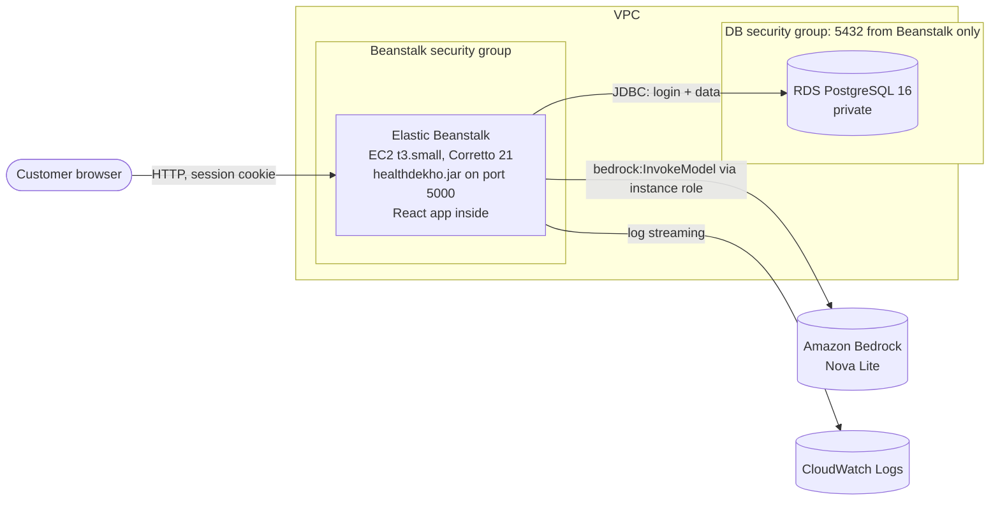

# Runbook – deploy HealthDekho on AWS

Target: **AWS Elastic Beanstalk (Java, Corretto 21)** running one JAR, **Amazon RDS for PostgreSQL 16**,
logs in **Amazon CloudWatch**, recommendations from **Amazon Bedrock**. All steps use the AWS console.
Placeholders look like `{RDS_ENDPOINT}`.

## AWS topology



GitHub draws this diagram when you open the file there; use that view for the slide 14 screenshot.

## 0. Before you start

- Pick one region and use it everywhere, e.g. `us-east-1`.
- Bedrock console → **Model access** → enable the model you'll use (default `amazon.nova-lite-v1:0`).
- Build the release JAR: `./scripts/build-release.sh` (Windows: `.\scripts\build-release.ps1`)
  → `backend/target/healthdekho.jar`.

## 1. Database (RDS)

1. RDS → Create database → Standard create → **PostgreSQL 16**.
2. Template: Free tier (or Dev/Test). Instance: `db.t4g.micro`.
3. DB instance identifier: `healthdekho-db`. Master username and password: choose them.
4. Connectivity: **Public access: No**. Security group: create `healthdekho-db-sg`.
5. Additional configuration → Initial database name: `healthdekho`.
6. Create, wait for **Available**, and note the **Endpoint**.

## 2. Application (Elastic Beanstalk)

1. Elastic Beanstalk → Create application → name `healthdekho`.
2. Environment tier: **Web server**. Platform: **Java**, branch **Corretto 21**.
3. Application code: **Upload your code** → `healthdekho.jar`, version label `1.0.0`.
4. Preset: **Single instance** (cheapest) or High availability (adds a load balancer).
5. Service access: let it create the default service role and EC2 instance profile
   (`aws-elasticbeanstalk-ec2-role`).
6. Instance type: `t3.small` (Spring Boot needs about 1 GB).
7. **Environment properties** (Configuration → Updates, monitoring and logging):

| Name | Value | Secret |
|---|---|---|
| `SERVER_PORT` | `5000` | No |
| `SPRING_PROFILES_ACTIVE` | `aws` | No |
| `DB_URL` | `jdbc:postgresql://{RDS_ENDPOINT}:5432/healthdekho` | No |
| `DB_USERNAME` | RDS master username | No |
| `DB_PASSWORD` | RDS master password | Yes |
| `DEMO_PASSWORD` | Password for the sample customers (first start only) | Yes |
| `AWS_REGION` | `{REGION}` | No |
| `BEDROCK_MODEL_ID` | `amazon.nova-lite-v1:0` | No |

8. Same page → **Instance log streaming to CloudWatch Logs: On** (retention 7 days).
9. Create the environment.

## 3. Permissions and network

- IAM → Roles → `aws-elasticbeanstalk-ec2-role` → Add inline policy:

```json
{
  "Version": "2012-10-17",
  "Statement": [
    {
      "Effect": "Allow",
      "Action": "bedrock:InvokeModel",
      "Resource": "arn:aws:bedrock:{REGION}::foundation-model/amazon.nova-lite-v1:0"
    }
  ]
}
```

  (The Converse API is authorised by `bedrock:InvokeModel`. If your region only offers the model through a
  cross-region inference profile such as `us.amazon.nova-lite-v1:0`, set `BEDROCK_MODEL_ID` to that id and also
  allow its `inference-profile` ARN.)

- EC2 → Security groups → `healthdekho-db-sg` → Inbound rule: **PostgreSQL, TCP 5432, source = the
  Beanstalk instance's security group** (named like `awseb-…`). No other inbound rules.

| Security group | Inbound | From |
|---|---|---|
| Beanstalk instance (`awseb-…`) | HTTP 80 | Internet (or the load balancer) |
| `healthdekho-db-sg` | TCP 5432 | Beanstalk instance security group only |

## 4. Smoke test

1. Beanstalk environment health turns **Green**. Open the environment URL.
2. Log in as `aarav.sharma@example.com` with `DEMO_PASSWORD` → dashboard shows HDP-2026-0001.
3. Available policies → HD-HEALTH-001 and HD-SAV-001 listed.
4. AI recommendations → results with reasons (badge "AI"; "Rule-based" means Bedrock wasn't reachable).
5. Register a policy → policy ID shown, and it appears on the dashboard. Log out → back to the login page.
6. CloudWatch → Log groups → `/aws/elasticbeanstalk/healthdekho-env/var/log/web.stdout.log` →
   look for `Login succeeded`, `Policy registered`, `Recommendation requestId=…`.

Screenshots for the deck: environment health + RDS Available (slide 15 left), CloudWatch log lines
(slide 15 right), Application versions + Events (slide 14 right). Blur passwords, keys and the account id.

## 5. Deploy a new version

1. `./scripts/build-release.sh`
2. Beanstalk → environment → **Upload and deploy** → new label (`1.0.1`, `1.0.2`, …).
3. Flyway applies any new migration on start. Check health and the smoke test again.

## 6. Roll back

Beanstalk → Application versions → select the previous label → **Deploy**.
Migrations only ever add (never edit V1/V2), so an older JAR still runs on the newer schema.

## 7. Stop costs after grading

1. Beanstalk → environment → Actions → **Terminate environment**.
2. RDS → `healthdekho-db` → Actions → **Delete** (take a final snapshot if you want to keep the data).
